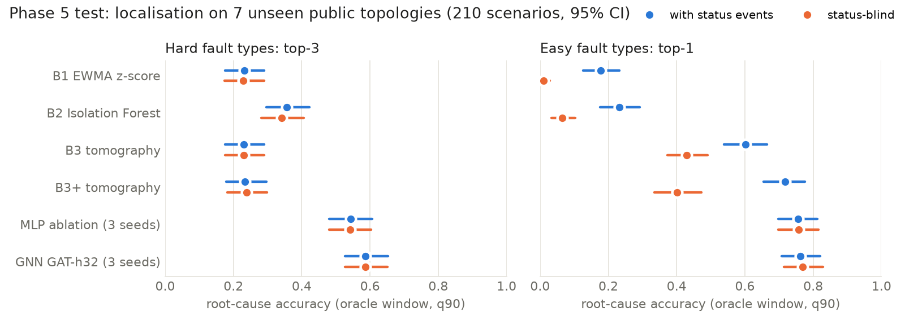
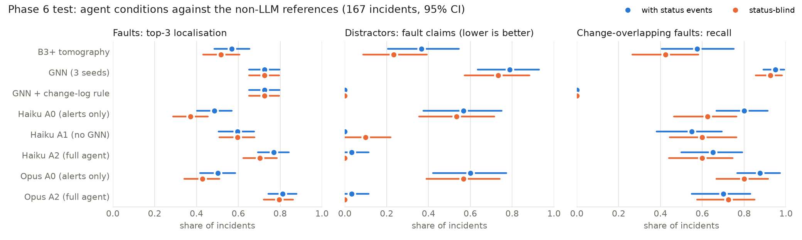
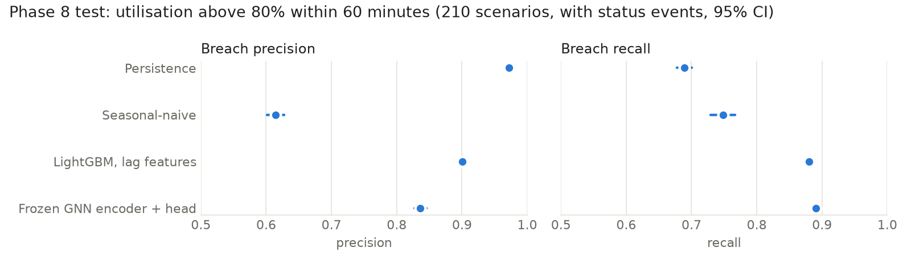

# NetTwin

NetTwin is a small digital twin of a telecom backbone, built from public data and measured end to end. It simulates network telemetry with injected faults on real public network maps. Then it tests how well three approaches find the root cause of an incident: classic baselines, a graph neural network (GNN), and a Claude-based agent that can query the network's knowledge graph, telemetry and change log. It also forecasts link congestion. Built as a portfolio project for the UTS Telecom Research Unit Project D.A.R.T. internship.

**Main limitation:** the telemetry is synthetic. It comes from our own simulator running on public topologies, not from any operator. Nothing here is Telstra's network or Telstra data. The results compare methods on realistic simulated faults; they do not show how any method would do in production.

## Headline results

Every result below was pre-registered: metrics and expectations were committed before any run, and each test set was scored once, on seven public networks never used during development.

- **Root cause of hard faults:** the GNN puts the true cause in its top 3 for 59% of hard faults, against 36% for the best classic baseline.
- **The agent's tools matter:** the full Claude Haiku 5.5 agent gets the root cause in its top 3 for 77% of faults, against 49% for the same model given only the alert list. Against the GNN on its own, the difference is not clear.
- **The change log cuts both ways:** the agent correctly treats planned maintenance as maintenance, but it flags only 65% of real faults that happen during a logged change, against 95% for the GNN.
- **Congestion forecasting:** LightGBM predicts which links will pass 80% utilisation within the next hour with F1 0.89, beating simple baselines. Reusing the GNN for this did not beat LightGBM.
- **Cost:** the whole project used $41.65 of API spend.

The full write-up, with every caveat and the negative results, is [docs/report.md](docs/report.md).

## Read this first

- **Telemetry is synthetic.** Traffic, alerts, faults and the change log come from our own simulator. Nothing here says how any method would do on a real network.
- **Topologies are public.** They come from the Internet Topology Zoo [Knight et al. 2011] and SNDlib [Orlowski et al. 2010] through `topohub` [Jurkiewicz 2023]. Training uses generated graphs only. References are in [section 9 of the report](docs/report.md#9-references).
- **This is not Telstra's network,** and no Telstra data is used anywhere.
- **Localisation uses an oracle incident window.** It starts and ends with the true fault, the same for every method. No method had to find the window itself.
- **AARNet is the dev and demo network.** It was used during development, so its results are reported separately and never pooled with test.
- **The audits were done by fresh Claude Code sessions, not by humans.** Each phase was audited by a new session (`docs/audit_*.md`), and every finding was fixed and logged by ID in [docs/decision_log.md](docs/decision_log.md). That is not a substitute for human review.
- **Headline results are pre-registered test results, each scored once** with frozen, hash-checked models and code. Anything else is labelled descriptive.
- **Negative results are reported** alongside the positive ones.
- Every number in this README and the report is checked against a results file by `scripts/check_numbers.py`.

## Run the demo

The demo reads only committed results. It needs no dataset and no API key.

```bash
conda env create -f environment.yml
conda activate nettwin
pip install -e .
streamlit run app/streamlit_app.py
```

It opens at http://localhost:8501 with four pages: an incident explorer for AARNet (map, knowledge graph, telemetry, alerts, change log, GNN ranking and the recorded Haiku 5.5 and Opus 5.5 agent traces), test results, capacity forecasting, and limitations.

## Results in detail (pre-registered, test set, scored once)

Test is seven public networks never used for design decisions (Geant2012, germany50, Garr201201, Peer1, York, Belnet2010, Ibm). CIs are 95% bootstrap intervals.

**Localisation (Phase 5, 210 scenarios).** The GNN (GAT-h32, 3 seeds) reaches hard top-3 0.587 with status events, against 0.356 for the best baseline (B2) and 0.234 for B3+. On easy types with status events, the GNN and B3+ show no clear difference (top-1 0.762 vs 0.718, difference +0.044 [-0.029, 0.122]). The near-perfect link_down and node_down scores come from the simulator's down-link rendering, not hard detection. The GNN raises an alarm in 0.475 of maintenance-only hours, more than every baseline.



**The agent (Phase 6, 167 incidents, Claude Haiku 5.5, `claude-haiku-5-5`).**
- The tools do real work: the full agent (A2) beats the alerts-only agent (A0) on faults top-3 by +0.283 with status events and +0.332 status-blind.
- Against the GNN alone, A2 shows no clear difference: +0.044 [-0.006, 0.095] and -0.022 [-0.079, 0.034].
- On maintenance distractors, A2 and the GNN + change-log rule both sit near 0 fault claims.
- On the 40 faults that overlap a logged change, A2 recalls fewer than the plain GNN (-0.300 and -0.325, contradicted). The agent too often takes the change as the explanation.
- 11 of 13 pre-registered expectations held on test.
- Opus 5.5 A2 vs A0 (pre-registered) is supported in both variants.
- Total project API spend: $41.65 of a $100 budget.



**Capacity forecasting (Phase 8, 210 scenarios).** Will a link exceed 80% utilisation within 60 minutes? LightGBM on lag features [Ke et al. 2017] has F1 0.890, above persistence (0.807) and seasonal-naive (0.675). The frozen Phase 5 GNN encoder with a small head is below LightGBM (F1 0.863, difference -0.027, contradicted).



**Descriptive, not pre-registered.**
- Opus A2 is above the 3-seed GNN on faults top-3 (+0.086 and +0.070). Against GNN seed 0, the checkpoint its tool uses, this holds only for faults top-3 with status events (+0.078 [0.021, 0.142]).
- Opus A2 is above Haiku A2 on faults top-1 (+0.108 and +0.117), at about 28 times the cost per incident.
- The AARNet dev traces (7 incidents) are a demo, not evidence.

## Setup and reproduction

```bash
conda env create -f environment.yml
conda activate nettwin
pip install -e .
python scripts/phase0_check_env.py
pytest
```

| Phase | Command | Writes |
|---|---|---|
| 1 KG | `python scripts/phase1_build_kg.py` | `results/phase1_kg_summary.json`, KG figures |
| 2 simulator | `python scripts/phase2_simulate.py` | `results/phase2_summary.json`, sanity figures |
| 3 datasets | `python scripts/phase3_build_dataset.py --workers 6` (about 8 GB, needs the key) | `data/datasets/v1` (gitignored) |
| 4 baselines | `python scripts/phase4_baselines.py --workers 6`, then `phase4_tables.py` | `results/phase4_tables.md` |
| 5 GNN | `phase5_gnn.py`, `phase5_freeze.py`, `phase5_test.py`, `phase5_tables.py` | `results/phase5_*.json`, `results/phase5_tables.md` |
| 6 agent | `phase6_agent.py --split val --model eval --name full`, `phase6_freeze.py`, `phase6_agent.py --split test --model eval`, `phase6_test_compare.py` | `results/phase6/` |
| 7 demo traces | `python scripts/phase7_aarnet_traces.py` | `results/phase7/` |
| 8 forecasting | `phase8_forecast.py`, then `phase8_forecast.py --test` | `results/phase8_*.json` |
| 10 write-up | `phase10_figures.py`, `check_numbers.py` | `results/figures/test_*.png` |

All scripts are in `scripts/`. The test scripts load frozen files only, refuse on any hash mismatch and refuse a second run. The agent scripts need `ANTHROPIC_API_KEY` in `.env` and spend money.

### Reproducing the datasets (needs the key)

Scenario seeds come from a secret 32-byte key in `.nettwin_dataset_key` (gitignored), so the repo alone cannot recover the faults behind the observable files (`docs/audit_phase3.md`). To rebuild `data/datasets/v1` byte for byte:
1. Clone the repo, create the env and run `pip install -e .`.
2. Copy the key file into the clone root as `.nettwin_dataset_key` (one line of hex, permissions 600).
3. Run `python scripts/phase3_build_dataset.py --workers 6`. The builder refuses without the key or if the frozen simulator changed.

To start a fresh dataset with different draws from the same distributions, write a new key:

```bash
python -c "import secrets; print(secrets.token_hex(32))" > .nettwin_dataset_key
```

## Where things are

- `src/nettwin/`: topology, knowledge graph, simulator, faults, alerts, baselines, evaluation harness, GNN, agent, forecasting.
- `app/streamlit_app.py`: the demo.
- `docs/decision_log.md`: decisions, pre-registrations, deviations and audit fixes. `docs/dataset_card.md`: the datasets. `docs/audit_*.md`: the audits.
- `results/`: every number reported, as JSON and Markdown tables.

## License

The code is under the MIT license ([LICENSE](LICENSE)). The topologies come from the Internet Topology Zoo and SNDlib through `topohub`, and they keep their own terms.
