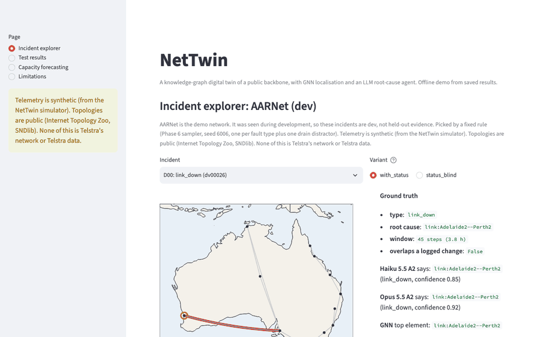
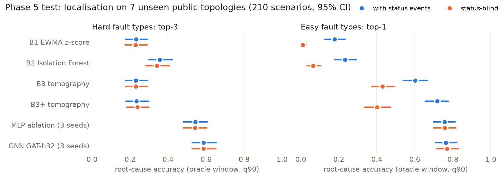
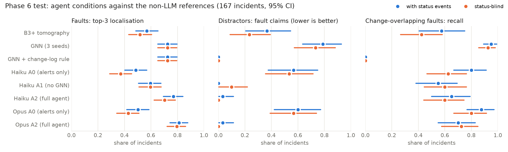
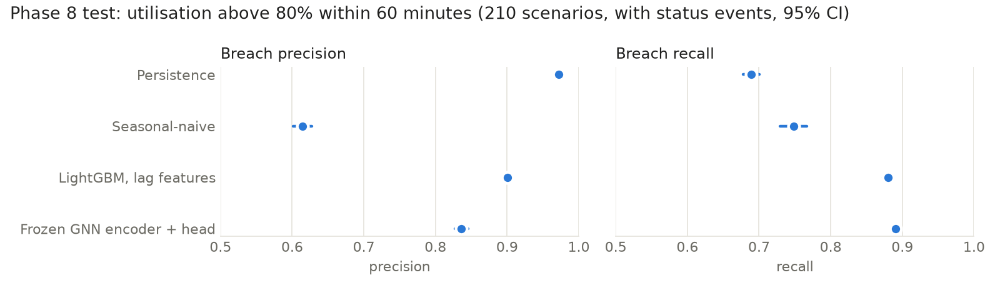

# NetTwin

**Live demo:** https://nettwin17.streamlit.app (runs from committed results; if it has been idle, click the wake-up button and wait a moment)



*The incident explorer on AARNet (a dev incident, seen during development): the map, each method's diagnosis next to the ground truth, and the recorded agent tool traces.*

NetTwin is a small digital twin of a telecom backbone, built from public data and measured end to end. It simulates network telemetry with injected faults on real public network maps. Then it tests how well three approaches find the root cause of an incident: classic baselines, a graph neural network (GNN), and a Claude-based agent that can query the network's knowledge graph, telemetry and change log. It also forecasts link congestion. Built as a portfolio project for the UTS Telecom Research Unit Project D.A.R.T. internship.

**Main limitation:** all telemetry is simulated, by our own simulator, on public network topologies. No real operator data is used, so results show behaviour in this simulator, not on a production network. They compare methods on realistic simulated faults.

## Headline results

Every result below was pre-registered: metrics and expectations were committed before any run, and each test set was scored once, on seven public networks never used during development.

- **Root cause of hard faults:** the GNN puts the true cause in its top 3 for 59% of hard faults, against 36% for the best classic baseline.
- **The agent's tools matter:** the full Claude Haiku 5.5 agent gets the root cause in its top 3 for 77% of faults, against 49% for the same model given only the alert list. Against the GNN on its own, the difference is not clear.
- **The change log cuts both ways:** the agent correctly treats planned maintenance as maintenance, but it flags only 65% of real faults that happen during a logged change, against 95% for the GNN.
- **Congestion forecasting:** LightGBM predicts which links will pass 80% utilisation within the next hour with F1 0.89, beating simple baselines. Reusing the GNN for this did not beat LightGBM.
- **Questions about the network graph (Phase 11):** given query tools over the knowledge graph, Claude Haiku 5.5 answers 94% of 252 exact test questions fully right, against 56% when given retrieved graph facts and 2% with no graph.
- **Without an oracle window (Phase 12):** replaying 210 test scenarios step by step, a Haiku 5.5 triage agent sends 60% fewer operator pages than the raw GNN alarm and catches 64% of faults against the GNN's 72%.
- **Cost:** the whole project used $52.29 of API spend.

The full write-up, with every caveat and the negative results, is [docs/report.md](docs/report.md).

## Read this first

- **Telemetry is synthetic.** Traffic, alerts, faults and the change log come from our own simulator. Nothing here says how any method would do on a real network.
- **Topologies are public.** They come from the Internet Topology Zoo [Knight et al. 2011] and SNDlib [Orlowski et al. 2010] through `topohub` [Jurkiewicz 2023]. Training uses generated graphs only. References are in [section 9 of the report](docs/report.md#9-references).
- **No real operator data.** All telemetry is simulated on public network topologies. No real operator data is used, so results show behaviour in this simulator, not on a production network.
- **Phases 4 to 6 use an oracle incident window.** Their localisation is scored on a window that starts and ends with the true fault, the same for every method, so no method had to find it. Phase 12 removes the window: it replays scenarios step by step and lets the GNN and the agent decide when to page.
- **AARNet is the dev and demo network.** It was used during development, so its results are reported separately and never pooled with test.
- **The audits were done by fresh Claude Code sessions, not by humans.** Each phase was audited by a new session (`docs/audit_*.md`), and every finding was fixed and logged by ID in [docs/decision_log.md](docs/decision_log.md). That is not a substitute for human review.
- **Headline results are pre-registered test results, each scored once** with frozen, hash-checked models and code. Anything else is labelled descriptive.
- **Negative results are reported** alongside the positive ones.
- Every number in this README and the report is checked against a results file by `scripts/check_numbers.py`.

## Run the demo

A hosted copy is at https://nettwin17.streamlit.app. The demo reads only committed results. It needs no dataset and no API key. To run just the demo, without the heavy project environment (no torch), install its three packages:

```bash
pip install -r app/requirements.txt
streamlit run app/streamlit_app.py
```

Or with the full project environment:

```bash
conda env create -f environment.yml
conda activate nettwin
pip install -e .
streamlit run app/streamlit_app.py
```

It opens at http://localhost:8501 with four pages: an incident explorer for AARNet (map, knowledge graph, telemetry, alerts, change log, GNN ranking and the recorded Haiku 5.5 and Opus 5.5 agent traces), test results, capacity forecasting, and limitations.

## Results in detail (pre-registered, test set, scored once)

Test is seven public networks never used for design decisions (Geant2012, germany50, Garr201201, Peer1, York, Belnet2010, Ibm). CIs are 95% bootstrap intervals.

**Localisation (Phase 5, 210 scenarios).** The GNN (GAT-h32, 3 seeds) reaches hard top-3 0.587 with status events, against 0.356 for the best baseline (B2) and 0.234 for B3+. On easy types with status events, the GNN and B3+ show no clear difference (top-1 0.762 vs 0.718, difference +0.044 [-0.029, 0.122]). The near-perfect link_down and node_down scores come from the simulator's down-link rendering, not hard detection. The GNN raises an alarm in 0.475 of maintenance-only hours, more than every baseline.



**The agent (Phase 6, 167 incidents, Claude Haiku 5.5, `claude-haiku-5-5`).**
- The tools do real work: the full agent (A2) beats the alerts-only agent (A0) on faults top-3 by +0.283 with status events and +0.332 status-blind.
- Against the GNN alone, A2 shows no clear difference: +0.044 [-0.006, 0.095] and -0.022 [-0.079, 0.034].
- On maintenance distractors, A2 and the GNN + change-log rule both sit near 0 fault claims.
- On the 40 faults that overlap a logged change, A2 recalls fewer than the plain GNN (-0.300 and -0.325, contradicted). The agent too often takes the change as the explanation.
- 11 of 13 pre-registered expectations held on test.
- Opus 5.5 A2 vs A0 (pre-registered) is supported in both variants.
- Total project API spend: $52.29 of a $100 budget.



**Capacity forecasting (Phase 8, 210 scenarios).** Will a link exceed 80% utilisation within 60 minutes? LightGBM on lag features [Ke et al. 2017] has F1 0.890, above persistence (0.807) and seasonal-naive (0.675). The frozen Phase 5 GNN encoder with a small head is below LightGBM (F1 0.863, difference -0.027, contradicted).



**Descriptive, not pre-registered.**
- Opus A2 is above the 3-seed GNN on faults top-3 (+0.086 and +0.070). Against GNN seed 0, the checkpoint its tool uses, this holds only for faults top-3 with status events (+0.078 [0.021, 0.142]).
- Opus A2 is above Haiku A2 on faults top-1 (+0.108 and +0.117), at about 28 times the cost per incident.
- The AARNet dev traces (7 incidents) are a demo, not evidence.

## KG question answering (Phase 11)

Can a small model answer exact questions about the network's inventory graph? 252 template test questions on the seven test networks, with exact answers computed by the knowledge-graph code. PoPs are renamed P01, P02 and so on, so no answer can come from knowing the real network. Six question types: one-hop lookups, multi-hop (which services cross this link), what-if (if this element fails, which services lose every path or get rerouted), paths (lowest and second-lowest cost), counts and time (what changed between two steps). All three conditions use Claude Haiku 5.5:

- **Q0:** the question alone, no graph.
- **Q1:** the question plus the 50 best BM25 matches from a one-fact-per-line text version of the graph.
- **Q2:** query tools over the existing KG API, at most 20 calls per question.

Set F1 on test (95% bootstrap CIs over questions; exact match in the app):

| questions | n | Q0 no graph | Q1 BM25 facts | Q2 KG tools |
|---|---|---|---|---|
| all | 252 | 0.024 [0.01, 0.04] | 0.636 [0.58, 0.69] | 0.970 [0.95, 0.99] |
| one-hop | 42 | 0.017 [0.00, 0.04] | 1.000 [1.00, 1.00] | 1.000 [1.00, 1.00] |
| multi-hop | 42 | 0.000 [0.00, 0.00] | 0.522 [0.38, 0.67] | 1.000 [1.00, 1.00] |
| what-if | 42 | 0.000 [0.00, 0.00] | 0.487 [0.35, 0.63] | 0.996 [0.99, 1.00] |
| path | 42 | 0.006 [0.00, 0.02] | 0.707 [0.57, 0.83] | 0.927 [0.85, 0.99] |
| count | 42 | 0.095 [0.02, 0.19] | 0.548 [0.40, 0.69] | 0.976 [0.93, 1.00] |
| time | 42 | 0.024 [0.00, 0.07] | 0.552 [0.45, 0.66] | 0.919 [0.87, 0.96] |

- Exact match overall: Q0 0.020, Q1 0.564, Q2 0.941. Q2 beats Q1 by +0.334 [0.279, 0.388] F1, and by graph size (small, medium, large) the gap is supported in every group.
- Q2's misses are mostly second-lowest-cost paths and "which services were rerouted between two steps", where it has to map rerouted PoP pairs back to services.
- Cost per question: Q0 $0.00011, Q1 $0.00063, Q2 $0.0014 with 3.48 tool calls on average. Phase 11 cost $0.84 in all, validation included.
- 6 of 7 pre-registered expectations held. E4 did not: retrieval was expected to score below 0.4 F1 on what-if, path and time questions, but scored 0.487, 0.707 and 0.552. Retrieved path facts often contain the answer outright.
- These are template questions on synthetic services and change histories over public topologies. They test whether the model can use the graph, not how it would handle an operator's free-form questions.

## Real-time replay (Phase 12)

Phases 4 to 6 score each method on an oracle window that starts and ends with the true fault. Phase 12 removes it. Each test scenario is replayed step by step from the end of its first day, as an operator would live it:

- The knowledge graph updates only from link and router status events as they arrive, with their polling delays.
- The frozen GNN scores every step and alarms at its frozen validation threshold. Repeated alarms on the same element merge into one alarm episode.
- Three policies decide which episodes page an operator. **GNN** pages every episode. **GNN + change-log rule** stays silent while a logged drain or planned outage is active. The **agent** (Claude Haiku 5.5) is woken when an episode opens, sees only data up to that step, and escalates with a root cause, dismisses it as maintenance or noise, or waits and re-checks once 30 minutes later.

Test: all 210 test scenarios, 1,260 scenario-days, 390 observable faults, 3,884 alarm episodes (95% CIs over scenarios):

| metric | GNN | GNN + change-log rule | Haiku 5.5 triage agent |
|---|---|---|---|
| pages per scenario-day | 3.08 [2.74, 3.43] | 2.63 [2.29, 2.97] | 1.24 [1.06, 1.44] |
| false pages per scenario-day | 2.31 [2.00, 2.62] | 1.91 [1.61, 2.23] | 0.66 [0.55, 0.78] |
| fault detection rate | 0.718 [0.68, 0.76] | 0.644 [0.60, 0.69] | 0.638 [0.59, 0.68] |
| time to detect (minutes) | 65.5 [47.8, 85.2] | 62.9 [45.0, 84.1] | 70.2 [48.1, 95.8] |
| root cause top-1 at escalation | 0.582 [0.53, 0.64] | 0.590 [0.53, 0.65] | 0.582 [0.52, 0.64] |
| root cause top-3 at escalation | 0.739 [0.68, 0.79] | 0.745 [0.69, 0.80] | 0.832 [0.78, 0.88] |
| missed faults during maintenance (56) | 0.143 [0.06, 0.24] | 0.518 [0.39, 0.64] | 0.375 [0.25, 0.50] |

- The agent sends 60% fewer pages than the raw GNN (-1.839 [-2.090, -1.592] per day) and catches fewer faults (-0.080 [-0.108, -0.051]). Against the change-log rule it detects about as many faults (-0.005 [-0.036, 0.028]) with about a third of the false pages.
- When it escalates, its top-3 root cause is better than the GNN's ranking (+0.092 [0.046, 0.146]); top-1 is level.
- It still misses more faults during maintenance than the raw GNN, though fewer than the change-log rule.
- Time to detect is about an hour for every policy, with wide CIs; the agent is not clearly slower.
- The raw GNN pages 3.08 times per scenario-day on test, against 1.39 on validation: its frozen threshold does not transfer across networks.
- 6 of 8 pre-registered expectations held. P5 (agent clearly later) and P6 (top-3 inconclusive) did not.
- Cost: the agent made 5,427 decisions for $0.0072 per scenario-day. The test run cost $9.12. Two changes were made to the plan, both logged: test grew from 70 to 210 scenarios before it started, and the spend guard was raised from $8.00 to $10.50 partway through, without changing anything else, after the agent waited more often than on validation.

## Setup and reproduction

```bash
conda env create -f environment.yml
conda activate nettwin
pip install -e .
python scripts/phase0_check_env.py
pytest
```

| Phase | Command | Writes |
|---|---|---|
| 1 KG | `python scripts/phase1_build_kg.py` | `results/phase1_kg_summary.json`, KG figures |
| 2 simulator | `python scripts/phase2_simulate.py` | `results/phase2_summary.json`, sanity figures |
| 3 datasets | `python scripts/phase3_build_dataset.py --workers 6` (about 8 GB, needs the key) | `data/datasets/v1` (gitignored) |
| 4 baselines | `python scripts/phase4_baselines.py --workers 6`, then `phase4_tables.py` | `results/phase4_tables.md` |
| 5 GNN | `phase5_gnn.py`, `phase5_freeze.py`, `phase5_test.py`, `phase5_tables.py` | `results/phase5_*.json`, `results/phase5_tables.md` |
| 6 agent | `phase6_agent.py --split val --model eval --name full`, `phase6_freeze.py`, `phase6_agent.py --split test --model eval`, `phase6_test_compare.py` | `results/phase6/` |
| 7 demo traces | `python scripts/phase7_aarnet_traces.py` | `results/phase7/` |
| 8 forecasting | `phase8_forecast.py`, then `phase8_forecast.py --test` | `results/phase8_*.json` |
| 10 write-up | `phase10_figures.py`, `check_numbers.py` | `results/figures/test_*.png` |

All scripts are in `scripts/`. The test scripts load frozen files only, refuse on any hash mismatch and refuse a second run. The agent scripts need `ANTHROPIC_API_KEY` in `.env` and spend money.

### Reproducing the datasets (needs the key)

Scenario seeds come from a secret 32-byte key in `.nettwin_dataset_key` (gitignored), so the repo alone cannot recover the faults behind the observable files (`docs/audit_phase3.md`). To rebuild `data/datasets/v1` byte for byte:
1. Clone the repo, create the env and run `pip install -e .`.
2. Copy the key file into the clone root as `.nettwin_dataset_key` (one line of hex, permissions 600).
3. Run `python scripts/phase3_build_dataset.py --workers 6`. The builder refuses without the key or if the frozen simulator changed.

To start a fresh dataset with different draws from the same distributions, write a new key:

```bash
python -c "import secrets; print(secrets.token_hex(32))" > .nettwin_dataset_key
```

## Where things are

- `src/nettwin/`: topology, knowledge graph, simulator, faults, alerts, baselines, evaluation harness, GNN, agent, forecasting.
- `app/streamlit_app.py`: the demo.
- `docs/decision_log.md`: decisions, pre-registrations, deviations and audit fixes. `docs/dataset_card.md`: the datasets. `docs/audit_*.md`: the audits.
- `results/`: every number reported, as JSON and Markdown tables.

## License

The code is under the MIT license ([LICENSE](LICENSE)). The topologies come from the Internet Topology Zoo and SNDlib through `topohub`, and they keep their own terms.
