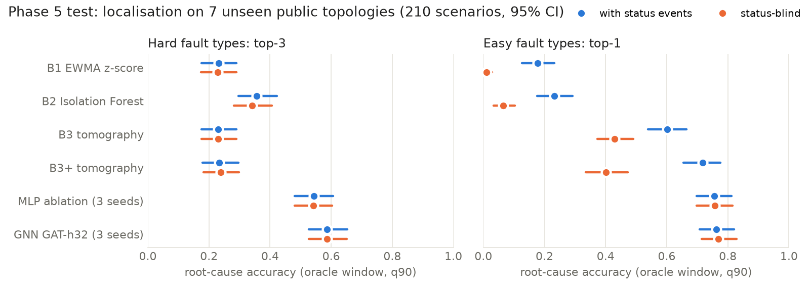
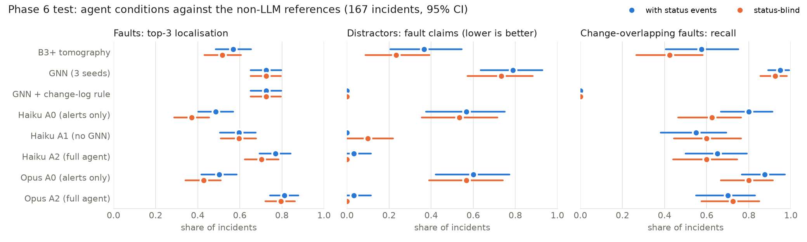
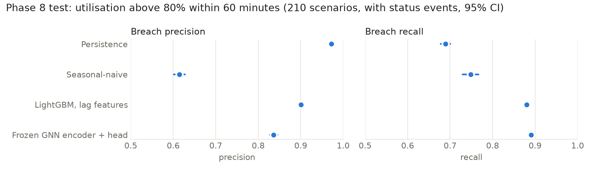

# NetTwin: report

A small, fully measured knowledge-graph digital twin of a telecom backbone, built on public data: a topology and knowledge graph layer, a telemetry simulator with injected faults, statistical and topology baselines, a graph neural network (GNN) for anomaly localisation, an LLM root-cause agent with tools, capacity forecasting, and an offline demo. Built as a portfolio project for the UTS Telecom Research Unit Project D.A.R.T. internship.

Every number here comes from a committed results file. `scripts/check_numbers.py` checks this report and the README against `results/`. Each citation was checked against its original source on 2026-10-31 (title, authors, year, venue, and that it supports the claim).

## 1. Read this first: what this is and is not

- **Synthetic telemetry.** Traffic, utilisation, latency, loss, alerts, the change log and every fault come from our own simulator (`src/nettwin/simulator.py`, `faults.py`). Real networks have messier telemetry, correlated failures and incomplete inventories. No result here says how any method would do on a real network.
- **Public topologies.** The networks are public research and education or ISP backbones from the Internet Topology Zoo [Knight et al. 2011] and SNDlib [Orlowski et al. 2010], loaded through the `topohub` package [Jurkiewicz 2023], whose Gabriel graph generator also makes the training graphs. Training uses generated graphs only.
- **Not Telstra's network.** There is no Telstra topology in these collections, and nothing here uses Telstra data.
- **The oracle incident window.** Localisation (Phases 4 to 6) is scored on a window that starts and ends with the true fault (or the logged change, for distractors). Every method gets the same window, but no method had to find it. Detection without that window is measured separately (link-level PR-AUC), and it is much harder.
- **AARNet is dev, not held-out.** AARNet (19 PoPs, 24 links) is the demo network. It was used to build and debug the simulator, so its results are reported separately and never pooled with test.
- **The audits were done by fresh Claude Code sessions, not by humans.** Each phase was audited by a new session with no access to the building session's context (`docs/audit_*.md`). Those audits found real problems (leakage in Phase 3, scoring asymmetries in Phase 6, overstated wording at the end), and every finding is logged and fixed by ID in `docs/decision_log.md`. They are not a substitute for human review.
- **Pre-registered or descriptive.** Each phase's expectations, metrics and test plan were committed before any validation or test run. Section 4 reports only pre-registered test results. Section 5 holds results that were not pre-registered, and each is labelled descriptive.
- **Negative results are reported** (section 6).

## 2. Why measure explanation, not just detection

A twin is only useful in operations if it helps someone explain an incident: which element failed, what kind of fault it is, and whether the symptom is really a planned change. So the project measures three things on the same incidents:
- root-cause localisation;
- false alarms on planned maintenance;
- for the agent, whether the evidence it cites exists in what its tools returned.

The comparison set is a statistical baseline, a topology heuristic (network tomography over alerts), a GNN, and an LLM agent with and without tools.

## 3. What was built

| Phase | What | Where |
|---|---|---|
| 0 to 1 | Topology loader and typed knowledge graph: PoP, Link, RoutingPath, CustomerService with SLA, Alert, Maintenance, Runbook | `src/nettwin/topology.py`, `kg.py` |
| 2 | Telemetry simulator (5-minute steps, 7 days per scenario, diurnal and weekly patterns, routing with ECMP, queueing latency and loss) with six fault types and maintenance distractors | `src/nettwin/simulator.py`, `faults.py` |
| 3 | Datasets split by topology: train 1232 scenarios on generated graphs, validation 468, test 210 (7 public networks), dev 30 (AARNet), each with and without status events | `docs/dataset_card.md` |
| 4 | Alerts, baselines B1 (EWMA z-score), B2 (Isolation Forest [Liu et al. 2008]), B3 and B3+ (binary tomography over alerts [Duffield 2006], scoring each element by the hit and coverage ratios of SCORE [Kompella et al. 2005]), and the shared evaluation harness | `src/nettwin/alerts.py`, `baselines.py`, `evaluation.py` |
| 5 | GNN on the line graph (GraphSAGE [Hamilton et al. 2017], GAT [Velickovic et al. 2018], GINE [Hu et al. 2020], in PyTorch Geometric [Fey and Lenssen 2019]) with detection and localisation heads; MLP and shuffled-edges ablations | `src/nettwin/gnn/` |
| 6 | Claude agent with knowledge-graph, telemetry, change-log, GNN and runbook tools; conditions A0, A1, A2 | `src/nettwin/agent/` |
| 7 | Offline Streamlit demo and AARNet agent traces | `app/streamlit_app.py` |
| 8 | Capacity forecasting (RQ5) | `src/nettwin/forecast.py` |

Fault types: link_down and node_down ("easy" types); link_flapping, link_degradation, demand_surge and routing_misconfig ("hard" types). Every scenario also has planned maintenance (drains, planned outages, no-op work), and some faults overlap it.

Each dataset scenario exists in two variants: `with_status` (the default telemetry, with interface status and reachability events) and `status_blind` (no status events, and down links fully missing). The second removes the easiest signal for link_down and node_down.

## 4. Headline results (pre-registered, test set, each scored once)

Test means seven public networks never used for any design decision: Geant2012, germany50, Garr201201, Peer1, York, Belnet2010 and Ibm. Each test set was scored once, with models, thresholds and code frozen and hash-checked beforehand. CIs are 95% scenario- or incident-bootstrap intervals (1000 resamples). A paired difference is "supported" when its CI excludes 0.

### 4.1 RQ1 and RQ2: detection and localisation (Phase 5, 210 test scenarios)



| method | hard top-1 | hard top-3 | easy top-1 | hard root PR-AUC | maintenance-hour alarms |
|---|---|---|---|---|---|
| B2 Isolation Forest | 0.200 | 0.356 | 0.232 | 0.029 | 0.287 |
| B3+ tomography | 0.113 | 0.234 | 0.718 | 0.020 | 0.184 |
| MLP ablation (3 seeds) | 0.376 | 0.543 | 0.755 | 0.049 | 0.445 |
| GNN GAT-h32 (3 seeds) | 0.431 | 0.587 | 0.762 | 0.074 | 0.475 |

With status events. Status-blind: GNN hard top-3 0.587, easy top-1 0.770; B3+ easy top-1 0.401.

- **Hard fault types:** the GNN localises far better than every baseline. Hard top-3 against B3+ is +0.353 [0.268, 0.431], supported. Hard root PR-AUC is low for every method (base rate 0.0025), but the GNN's 0.074 is the highest.
- **Easy types with status events:** the GNN and B3+ show no clear difference (easy top-1 +0.044 [-0.029, 0.122]). Without status events the GNN is far ahead (+0.369 [0.284, 0.455]).
- **The near-perfect link_down and node_down scores reflect the simulator's down-link rendering** (a down interface reads exactly 0 traffic), which the model learns to recognise. That is not hard detection.
- **Hardest types for the GNN** (top-3, with status): link_degradation 0.516, routing_misconfig 0.516 and link_flapping 0.552. On link_flapping, B3 has the higher point estimate (0.681), but that expectation (X4) was inconclusive on test.
- **Maintenance:** the GNN raises an alarm in 0.475 of maintenance-only hours, more than any baseline. Its pre-registered expectation of fewer alarms than B2 (X9) was not met.

### 4.2 RQ3: synthetic to real

The GNN was trained only on generated graphs. On the seven unseen public networks, its hard top-3 (0.587) is close to its validation value (0.606), and per network it ranges from 0.377 (York) to 0.700 (Ibm). The pre-registered transfer check (X5, real minus generated top-3 above -0.10) was inconclusive on validation, so transfer is not established. These test networks are real topologies with synthetic telemetry: this is transfer across graph structure only.

### 4.3 RQ1 ablation: does the graph help?

The MLP ablation keeps the same features and heads but drops message passing. The GNN beats it on hard top-3 (+0.044 [0.014, 0.072] with status events), but on easy top-1 the difference is inconclusive. Most of the gain over the baselines comes from supervised training on link telemetry, not from message passing. The pre-registered "the graph helps" expectation (X6) was not met on validation and was inconclusive on test.

### 4.4 RQ4: the agent (Phase 6, 167 test incidents)



**Incidents and conditions.**
- The 167 incidents are 120 main-sample faults (20 per type), 30 maintenance distractors (15 drains, 15 planned outages) and 17 extra faults from a change-overlap stratum. The 40 faults that overlap a logged change are those 17 plus 23 of the 120.
- A0 is the LLM with the alert list only. A1 adds knowledge-graph, telemetry and change-log tools. A2 adds the GNN and runbook tools.
- The main model is Claude Haiku 5.5 (`claude-haiku-5-5`), with A0, A1 and A2. The secondary model is Claude Opus 5.5 (`claude-opus-5-5`), with A0 and A2 [Anthropic 2026].
- The agent's budget is 15 tool calls per incident.

| method | with status: faults top-1 / top-3 | distractor fault claims | change-overlap recall | status-blind: faults top-1 / top-3 | distractor fault claims | change-overlap recall |
|---|---|---|---|---|---|---|
| B3+ | 0.438 / 0.568 | 0.367 | 0.575 | 0.309 / 0.518 | 0.233 | 0.425 |
| GNN (3 seeds) | 0.575 / 0.725 | 0.789 | 0.950 | 0.569 / 0.725 | 0.733 | 0.925 |
| GNN + change-log rule | 0.575 / 0.725 | 0.000 | 0.000 | 0.569 / 0.725 | 0.000 | 0.000 |
| Haiku A0 | 0.413 / 0.486 | 0.567 | 0.800 | 0.305 / 0.371 | 0.533 | 0.625 |
| Haiku A1 | 0.492 / 0.597 | 0.000 | 0.550 | 0.425 / 0.596 | 0.100 | 0.600 |
| Haiku A2 | 0.533 / 0.769 | 0.033 | 0.650 | 0.525 / 0.703 | 0.000 | 0.600 |
| Opus A0 | 0.405 / 0.502 | 0.600 | 0.875 | 0.339 / 0.428 | 0.567 | 0.800 |
| Opus A2 | 0.642 / 0.811 | 0.033 | 0.700 | 0.642 / 0.795 | 0.000 | 0.725 |

"Distractor fault claims" is the share of the 30 maintenance windows where the method claims a fault (lower is better). "Change-overlap recall" is the share of the 40 change-overlapping faults where it claims one.

**The tools do real work** (pre-registered, Haiku 5.5).
- A2 beats A0 on faults top-3 (+0.283 [0.196, 0.377] with status events; +0.332 [0.241, 0.424] status-blind) and on hard fault-type accuracy (+0.267; +0.250).
- A1 beats A0 on faults top-1 in both variants (+0.078; +0.120).
- Opus 5.5 shows the same pattern: A2 - A0 faults top-3 +0.310 and +0.366, supported.

**Against the best non-LLM localiser.**
- Haiku A2 against the GNN shows no clear difference at this sample size: faults top-3 +0.044 [-0.006, 0.095] with status events, -0.022 [-0.079, 0.034] status-blind.
- On hard top-1, the pre-registered expectation G3 (inconclusive) held. The agent mostly follows its GNN tool.
- Haiku A1 (no GNN tool) is below the GNN on faults top-3 (-0.128; -0.129, contradicted).

**Against the GNN + change-log rule.**
- This rule was added after the Phase 6 audit. It silences the GNN whenever the change log shows a drain or outage overlapping the window.
- On distractors, the agents and the rule both sit at about 0 fault claims (inconclusive). The agents' low false-alarm rate comes from reading the change log, which a one-line rule also does. That is a description, not a tested equivalence.
- The agents recall more faults than the rule: Haiku A2 +0.219 and +0.208 on main-sample faults, and +0.650 and +0.600 on change-overlapping faults.

**The price of the change log.** On faults that overlap a logged change, every agent with the change log claims a fault less often than the plain GNN. Haiku A2 is at -0.300 and -0.325, and Opus A2 at -0.250 and -0.200, all contradicted. The agents too often take a logged change as the explanation.

**Groundedness.** The share of cited ids and numbers missing from the run's tool outputs:

| condition | lenient rate | strict rate (numbers verbatim) |
|---|---|---|
| Haiku A1 | 1.0% and 0.9% | 8.9% and 8.8% |
| Haiku A2 | 1.2% and 0.9% | 6.0% and 6.0% |

This checks that cited elements and numbers exist. It does not check that the explanation linking them is right.

**Cost.**
- Haiku A2 cost $0.0025 to $0.0028 per incident; Opus A2 cost $0.072 to $0.078.
- The Haiku test run cost $1.96 and the Opus test run $32.68.
- Total project API spend was $41.65 of a $100 budget.

**Pre-registered expectations on test** (Haiku 5.5, G1 to G13): 11 of 13 held.
- G1 (A1 beats A0 on hard top-1) held only status-blind.
- G2 (A2 beats A1 on hard top-1) did not hold in either variant.
- Both had held on validation.

### 4.5 RQ5: capacity forecasting (Phase 8, 210 test scenarios)



Will a link's observed utilisation exceed 80% within the next 60 minutes? Predictions are made every 30 minutes for every link, from causal inputs only. Results are for the variant with status events.

| method | precision | recall | F1 |
|---|---|---|---|
| Persistence (above 0.8 now) | 0.972 [0.970, 0.975] | 0.689 [0.678, 0.700] | 0.807 |
| Seasonal-naive (same hour yesterday) | 0.615 [0.601, 0.628] | 0.749 [0.729, 0.767] | 0.675 |
| LightGBM on lag features [Ke et al. 2017] | 0.900 [0.895, 0.905] | 0.880 [0.873, 0.886] | 0.890 |
| Frozen Phase 5 GNN encoder + small head | 0.836 [0.827, 0.846] | 0.891 [0.885, 0.896] | 0.863 |

- **LightGBM** beats persistence on F1 by +0.083 [0.079, 0.088] and seasonal-naive by +0.215, both supported.
- **Persistence** has the highest precision.
- **The frozen GNN encoder with a head** is below LightGBM (F1 -0.027 [-0.031, -0.024], contradicted). This says the frozen encoder plus a small head is worse than LightGBM on lag features. It does not test whether the embedding adds anything to those features.
- **Window classes.** 83% of test breaches fall in fault-free windows. Recall in fault windows is lower than in fault-free windows for three methods but not for persistence. The maintenance class (114 breaches) carries no conclusion.
- **Expectations:** 3 of 6 held.

## 5. Descriptive results (not pre-registered)

- **Opus A2 against the GNN.**
  - Opus A2 is above the 3-seed GNN on faults top-3: +0.086 [0.036, 0.142] with status events, +0.070 [0.014, 0.127] status-blind.
  - Against GNN seed 0, the checkpoint its own tool uses, this holds only for faults top-3 with status events (+0.078 [0.021, 0.142]). Status-blind top-3 (+0.053 [-0.005, 0.112]) and top-1 in both variants are inconclusive.
  - Only Opus A2 - A0 was pre-registered.
- **Haiku 5.5 against Opus 5.5.**
  - Paired over the same test incidents, Opus A2 is above Haiku A2 on faults top-1 (+0.108 [0.041, 0.182] and +0.117 [0.048, 0.189]) and on hard top-1 (+0.167 and +0.150).
  - The comparison file holds 68 paired comparisons (27 supported, 41 inconclusive) with no multiple-comparison correction, so some supported verdicts are expected by chance.
  - Opus A2 costs about 28 times as much per incident.
- **AARNet dev traces (Phase 7).**
  - Haiku A2 and Opus A2 ran on 7 AARNet incidents (one per fault type plus one drain), picked by a fixed rule, in both variants, for $0.92.
  - Both models had faults top-1 0.500, the same as the GNN.
  - Both labelled the drain as planned maintenance. Both called the demand_surge incident "no fault".
  - Six faults are too few to compare methods.
- **AARNet dev, Phases 5 and 8.**
  - Reported separately in `results/phase5_test.json` and `results/phase8_test.json`.
  - For Phase 8, LightGBM F1 is above persistence there too (+0.066 [0.022, 0.122]).

## 6. Negative results

- **Hard top-1 on test:** the GNN tool did not help on hard top-1 (G2 not met), and A1 beat A0 there only without status events (G1). Both expectations held on validation.
- **Faults coinciding with logged changes:** agents with the change log miss more of these than the plain GNN.
- **Maintenance alarms:** the GNN raises an alarm in about half of maintenance-only hours (0.475 with status events, 0.458 status-blind), more than every baseline (X9 not met).
- **Message passing:** it adds little over an MLP on the same features (X6 not met on validation).
- **Easy faults with status events:** the GNN is not distinguishable from B3+ there.
- **Synthetic-to-real transfer:** not established (X5 inconclusive).
- **Forecasting:** the frozen GNN encoder with a head lost to LightGBM. Two other forecasting expectations were not met (F5, F6).

## 7. How the work was kept honest

- **Splits.** Data was split by topology first. No test topology appears in training in any form. Generated training graphs were augmented only from a reference pool that excludes test and dev networks.
- **Pre-registration.** Expectations, metrics, tuning budgets and test plans were committed before the runs they describe. Every change has a dated entry and reason in `docs/decision_log.md`.
- **Test once.** Models, thresholds, calibration and agent code were frozen and hash-checked before each test run (`results/phase5_frozen.json`, `results/phase6_frozen.json`, `results/phase8_frozen.json`). The test scripts refuse a second run.
- **Banned inputs.** No method sees a clock, the time since the scenario start, or file metadata. All features are causal.
- **Disclosed weaknesses.**
  - The runbooks were written by us with knowledge of the simulator's fault types, which favours the agent.
  - The agent's fault claim (a classification) differs in kind from the references' (a frozen threshold).
  - Phase 8 tuning broke a tie by grid order, which was not pre-registered.
  - Phase 8 per-scenario test counts were not saved, so its CIs can be checked only by rescoring.
- **Audits.** Fresh Claude Code sessions audited every phase; their findings and fixes are in the decision log by ID. A final audit checked every headline number against its results file and found no mismatch. A fresh-clone check rebuilt the datasets and reproduced the Phase 8 models byte for byte.

## 8. Reproduce and run the demo

The demo reads only committed results, so it needs no data and no API key:

```bash
conda env create -f environment.yml
conda activate nettwin
pip install -e .
streamlit run app/streamlit_app.py
```

The README lists the scripts for each phase. Rebuilding the datasets byte for byte needs the private dataset key (`docs/audit_phase3.md`). The agent runs need an Anthropic API key and spend money.

## 9. References

Checked against the original sources on 2026-10-31.

- [Anthropic 2026] Anthropic. Models overview, Claude Platform documentation. https://platform.claude.com/docs/en/models/overview (accessed 2026-10-31).
- [Duffield 2006] Duffield, N. Network tomography of binary network performance characteristics. IEEE Transactions on Information Theory, 52(12), 5373 to 5388, 2006.
- [Fey and Lenssen 2019] Fey, M., Lenssen, J. E. Fast graph representation learning with PyTorch Geometric. ICLR Workshop on Representation Learning on Graphs and Manifolds, 2019. arXiv:1903.02428.
- [Hamilton et al. 2017] Hamilton, W. L., Ying, R., Leskovec, J. Inductive representation learning on large graphs. Advances in Neural Information Processing Systems 30 (NIPS 2017), 1024 to 1034.
- [Hu et al. 2020] Hu, W., Liu, B., Gomes, J., Zitnik, M., Liang, P., Pande, V., Leskovec, J. Strategies for pre-training graph neural networks. ICLR 2020. (GINE, the edge-feature variant of GIN, as attributed by PyTorch Geometric's GINEConv.)
- [Jurkiewicz 2023] Jurkiewicz, P. TopoHub: A repository of reference Gabriel graph and real-world topologies for networking research. SoftwareX, 24, 101540, 2023. doi:10.1016/j.softx.2023.101540.
- [Ke et al. 2017] Ke, G., Meng, Q., Finley, T., Wang, T., Chen, W., Ma, W., Ye, Q., Liu, T.-Y. LightGBM: A highly efficient gradient boosting decision tree. Advances in Neural Information Processing Systems 30 (NIPS 2017), 3146 to 3154.
- [Knight et al. 2011] Knight, S., Nguyen, H. X., Falkner, N., Bowden, R., Roughan, M. The Internet Topology Zoo. IEEE Journal on Selected Areas in Communications, 29(9), 1765 to 1775, 2011.
- [Kompella et al. 2005] Kompella, R. R., Yates, J., Greenberg, A., Snoeren, A. C. IP fault localization via risk modeling. 2nd USENIX Symposium on Networked Systems Design and Implementation (NSDI 2005).
- [Liu et al. 2008] Liu, F. T., Ting, K. M., Zhou, Z.-H. Isolation forest. Eighth IEEE International Conference on Data Mining (ICDM 2008), 413 to 422.
- [Orlowski et al. 2010] Orlowski, S., Wessaly, R., Pioro, M., Tomaszewski, A. SNDlib 1.0: Survivable network design library. Networks, 55(3), 276 to 286, 2010.
- [Velickovic et al. 2018] Velickovic, P., Cucurull, G., Casanova, A., Romero, A., Lio, P., Bengio, Y. Graph attention networks. ICLR 2018.
